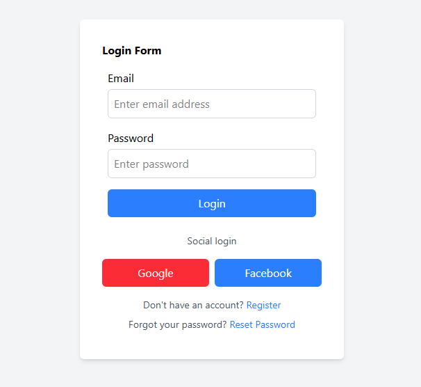
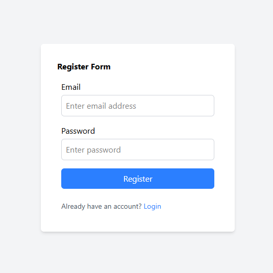
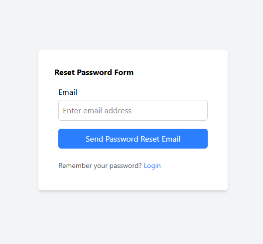
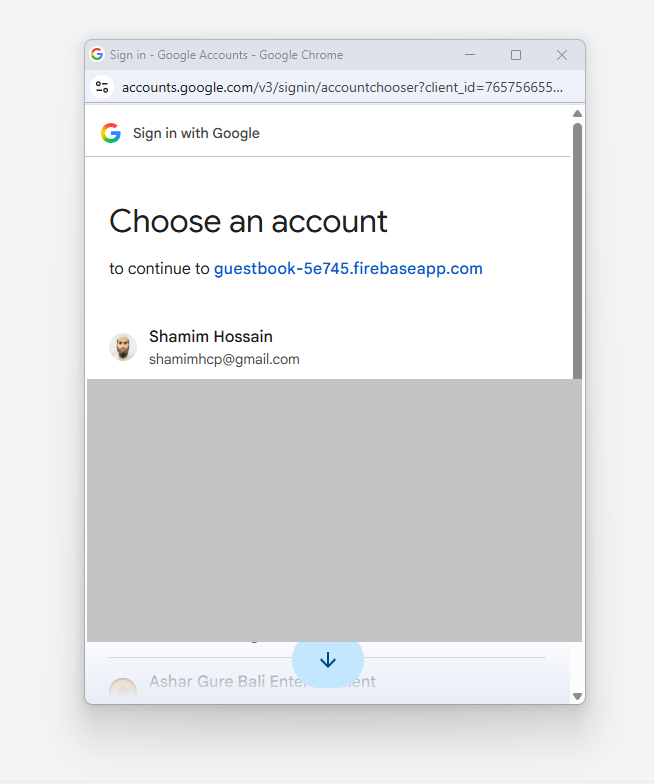
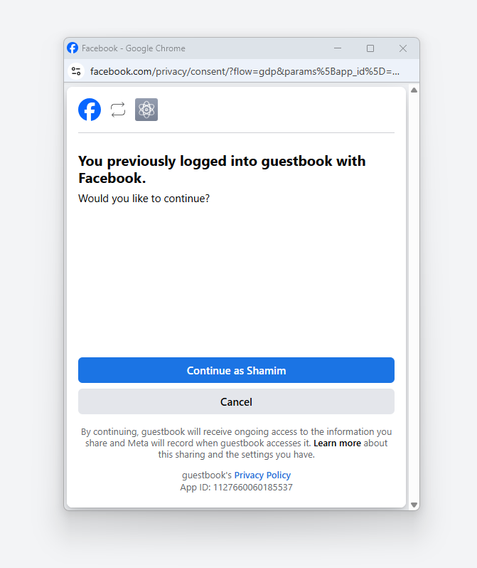
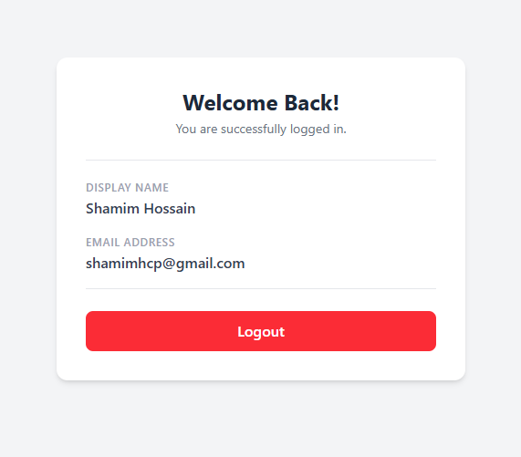

# Auth in React with Firebase

A React authentication app built while following the **Learn with Sumit (LWS)** crash course *"How to do Authentication in React with Firebase"*.

The course covered **email/password** and **Google** login. The assignment was to add **Facebook login** on top, which is implemented here, along with styling for every page and protection of the `/home` route.

**Extra, not covered in the LWS video:** I also upgraded the project to use [React Hook Form](https://react-hook-form.com/) (`useForm`) for form handling and validation in the Login, Register and Reset Password pages.

## Features

- Register with email and password
- Login with email and password
- Login with Google
- Login with Facebook (my assignment)
- Reset password by email
- Protected `/home` route: it can't be viewed without logging in, and visitors are redirected to `/login`
- Logout
- Every page is styled with Tailwind CSS
- Forms built with React Hook Form (my own addition, not in the LWS video)

## Tech Stack

- [React 19](https://react.dev/) + [Vite](https://vite.dev/)
- [Firebase Authentication](https://firebase.google.com/docs/auth)
- [react-firebase-hooks](https://github.com/CSFrequency/react-firebase-hooks) for the auth state
- [React Router](https://reactrouter.com/) for routing
- [React Hook Form](https://react-hook-form.com/) for forms (not covered in the LWS video)
- [Tailwind CSS 4](https://tailwindcss.com/) for styling

## Screenshots

### Pages

<table>
  <tr>
    <th align="center">Login</th>
    <th align="center">Register</th>
    <th align="center">Reset Password</th>
  </tr>
  <tr>
    <td align="center"></td>
    <td align="center"></td>
    <td align="center"></td>
  </tr>
  <tr>
    <td align="center">Email/password plus Google and Facebook buttons</td>
    <td align="center">Create a new account</td>
    <td align="center">Get a reset link by email</td>
  </tr>
</table>

### Social Login

<table>
  <tr>
    <th align="center">Google</th>
    <th align="center">Facebook</th>
  </tr>
  <tr>
    <td align="center"></td>
    <td align="center"></td>
  </tr>
  <tr>
    <td align="center">Choose an account to continue</td>
    <td align="center">Confirm and continue with Facebook</td>
  </tr>
</table>

### Home (Protected)

<table>
  <tr>
    <th align="center">Home</th>
  </tr>
  <tr>
    <td align="center"></td>
  </tr>
  <tr>
    <td align="center">Shows the logged-in user's name and email</td>
  </tr>
</table>

## Routes

| Route       | Description                              | Access                          |
| ----------- | ---------------------------------------- | ------------------------------- |
| `/login`    | Login with email/password, Google, Facebook | Public                       |
| `/register` | Create a new account                     | Public                          |
| `/reset`    | Send a password reset email              | Public                          |
| `/home`     | Shows the logged-in user's name and email | **Protected** (login required) |

### How `/home` is protected

`src/page/Home.jsx` uses the `useAuthState(auth)` hook from `react-firebase-hooks`. While Firebase is checking the session it shows a loading message. If there is no logged-in user, it redirects to `/login`. The page content only renders when a user exists.

## Run it locally

### What you need

- [Node.js](https://nodejs.org/) 18 or newer, and npm
- A Google account, to create a free Firebase project
- A Facebook developer account, only if you want Facebook login

### 1. Clone and install

```bash
git clone <your-repo-url>
cd Auth-in-React-Me
npm install
```

### 2. Create a Firebase project

1. Go to the [Firebase Console](https://console.firebase.google.com/) and click **Add project**.
2. In the project, click **Add app → Web (`</>`)** and register the app.
3. Copy the `firebaseConfig` values shown. You will need them in step 3.
4. Go to **Build → Authentication → Get started → Sign-in method** and enable:
   - **Email/Password**
   - **Google**
   - **Facebook** (see the Facebook section below)

### 3. Add your environment variables

Copy `.env.example` to `.env.local` and fill in your Firebase values:

```env
VITE_FIREBASE_API_KEY=your_api_key
VITE_FIREBASE_AUTH_DOMAIN=your_project_id.firebaseapp.com
VITE_FIREBASE_PROJECT_ID=your_project_id
VITE_FIREBASE_STORAGE_BUCKET=your_project_id.firebasestorage.app
VITE_FIREBASE_MESSAGING_SENDER_ID=your_sender_id
VITE_FIREBASE_MESSAGING_APP_ID=your_app_id
```

| Variable | Where to find it (`firebaseConfig`) |
| --- | --- |
| `VITE_FIREBASE_API_KEY` | `apiKey` |
| `VITE_FIREBASE_AUTH_DOMAIN` | `authDomain` |
| `VITE_FIREBASE_PROJECT_ID` | `projectId` |
| `VITE_FIREBASE_STORAGE_BUCKET` | `storageBucket` |
| `VITE_FIREBASE_MESSAGING_SENDER_ID` | `messagingSenderId` |
| `VITE_FIREBASE_MESSAGING_APP_ID` | `appId` |

> Note: `VITE_FIREBASE_MESSAGING_APP_ID` holds the Firebase **`appId`**. The name is just how it is referenced in `src/firebase.js`.

Never commit your real `.env.local` file.

### 4. Start the app

```bash
npm run dev
```

Open the URL shown in the terminal (usually `http://localhost:5173/login`).

### Other scripts

```bash
npm run build     # production build
npm run preview   # preview the production build
npm run lint      # run ESLint
```

## How I created the Facebook app (for Facebook login)

Facebook login needs a Facebook app that gives you an **App ID** and **App Secret**, which Firebase uses to talk to Facebook.

1. Go to [Meta for Developers](https://developers.facebook.com/) and log in. Register as a developer if it's your first time.
2. Click **My Apps → Create App**.
3. Enter the app name (I used **guestbook**) and your contact email.
4. Choose the use case **Authenticate and request data from users with Facebook Login**, then finish creating the app.
5. Open **App settings → Basic** and copy the **App ID** and **App Secret**.
6. In **Firebase Console → Authentication → Sign-in method → Facebook**, turn it on and paste the App ID and App Secret.
7. Firebase now shows an **OAuth redirect URI**, which looks like `https://<your-project-id>.firebaseapp.com/__/auth/handler`. Copy it.
8. Back on Facebook, go to **Facebook Login → Settings**, paste that URI into **Valid OAuth Redirect URIs**, and save.
9. Test it by clicking **Continue with Facebook** on the login page.

Tips:

- While the Facebook app is in **Development mode**, only people with a role on the app (Admin, Developer or Tester) can log in. Add them under **App roles → Roles**. Switch the app to **Live** to let everyone log in.
- Make sure `localhost` is listed under **Firebase → Authentication → Settings → Authorized domains**. It is there by default.
- If a user's Facebook and Google accounts use the same email, Firebase may report that the account already exists with a different sign-in method.

## Project Structure

```
public/            # screenshots and static assets
src/
├── components/    # Field and FieldSet form components
├── page/          # Home, Login, Register, Reset pages
├── firebase.js    # Firebase setup and auth helper functions
├── App.jsx        # Routes
└── main.jsx       # App entry point
```

## Credits

Built following the [Learn with Sumit](https://learnwithsumit.com/) course *How to do Authentication in React with Firebase*. The Facebook login, styling, the `/home` route protection and the React Hook Form integration (which the video did not cover) are my own additions.
